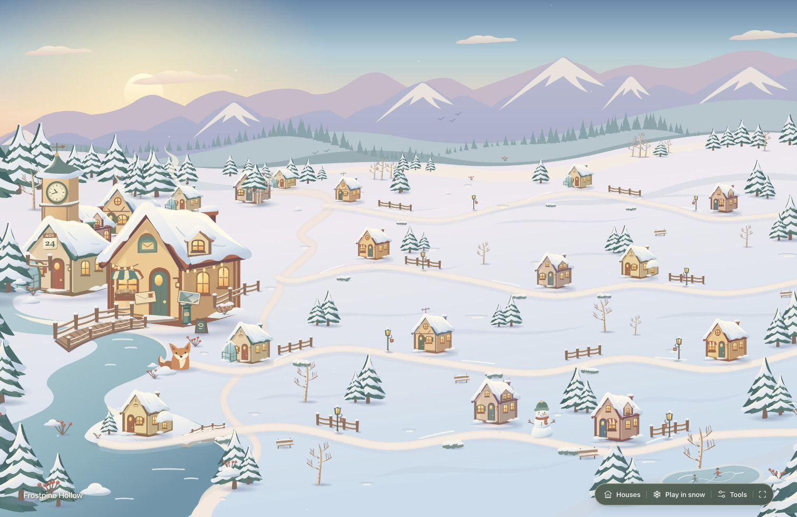

# Snowfall OS

An illustrated winter desktop for macOS. Follow the snowy streets to your folder cottages, pick up a loose file at the post office, or glance at the town clock. The buildings share a ground plane, perspective, and light with the landscape. A little fox waits by the creek.



[Download for Mac](https://github.com/ult666666/snowfall-os/releases/latest/download/Snowfall-OS-macOS.zip) · [Explore the sample town](https://ult666666.github.io/snowfall-os/?v=5.0.0)

## Move into the village

On macOS 12 or later, unzip the download and open **Snowfall OS.app**. The snowflake in the menu bar controls the live scene. The app is built for Apple silicon and Intel. Its public binary has an ad-hoc signature and has not been notarized by Apple.

1. Choose **Folder Houses → Style Desktop Folders as Houses** from the snowflake menu. With desktop items hidden in macOS, the folders take up plots along the painted streets. Hover to read a name, click for a brief snowball exchange, or double-click to open the actual folder. A cottage’s context menu also leads to its notebook and focus timer.
2. Pick up a letter on the post-office counter to open its file. The two counter spaces favor documents and pictures. Click the building to browse all loose Desktop items, including packages and aliases. The sorting desk can reveal any item in Finder.
3. Read the tower for local time. Its clock face opens Clock on supported Macs. In the browser you can switch the time format. Snowfall reads device time locally.
4. If you show existing widgets on the desktop, enable **Frame Desktop Widgets** in the snowflake menu. The artwork follows their bounds and leaves the controls to macOS. Each widget’s app supplies its content and appearance.
5. Choose **Wallpaper Image → Set Village as Mac Wallpaper** to save the occupied streets as the system picture. Snowfall updates the picture when its composition changes. The still picture stays when you quit. Open the app for working doors, time, and snow play.

For the composed layout, use **System Settings → Desktop & Dock** to hide Desktop items and choose **Only in Stage Manager** for **Click wallpaper to reveal desktop** with Stage Manager off. If you prefer visible Finder items, the village follows their real positions. File access stays available through Finder in either view.

**To undo the desktop changes**, use **Folder Houses → Restore Original Folder Icons** and **Wallpaper Image → Restore Previous Mac Wallpaper and Quit**. Snowfall saves the original icon state before styling. Choosing a different system picture also stops automatic picture updates.


## How the drawing stays connected to the Mac

The landscape and the native door buttons share one placement plan. Each lot specifies where the front step meets the street and how large the building is at that depth. The Mac projects that plan onto the available display and reserves space for system widgets. Only the painted buildings receive native controls. Finder keeps its own icon positions. On crowded or heavily cropped displays, every folder is also available through **Folder Houses → Open a House…**.

The post office watches the Desktop directory for changes. On a click, it checks that the item still has the expected identity before opening or revealing it. The still wallpaper stores the buildings and pieces of mail without filenames. The public website uses twelve fictional folders and three sample pieces of mail. [Placement plan](assets/village-plan.json) · [Native placement](macos/VillageComposition.swift) · [Local file handling](macos/PostOffice.swift)

The six 256-pixel cottage images are reused at different scales. Snowfall stores a compact Finder icon for each styled folder, plus a local backup of its previous icon when needed. The desktop picture cache reuses two JPEG slots per display. Snow and music run locally.

## Snow play

Choose **Roll a Snowball** three times to build Flurry directly on your wallpaper. Another roll prompts a return toss. **Send the Snowplow** pushes the next pile into a snowbank. For a full game, choose **Play in Snow**, challenge Flurry, and dodge with the arrow keys. The first to land three hits wins.

The browser preview uses fictional sample folders. It runs the same widget and game code and stores sample notes locally. Finder integration, desktop widget frames, and system wallpaper changes are available in the Mac app.

## Build on your Mac

Install Apple’s Command Line Tools, then run these commands from the project folder.

```sh
./build-mac.sh
open "build/Snowfall OS.app"
```

The bundled app works offline. To run its isolated integration check, execute `"build/Snowfall OS.app/Contents/MacOS/SnowfallOS" --smoke-test`. It exercises folder styling and restoration using temporary folders.

## Learn how an AI product takes shape

A folder has a persistent identity, a position in the drawing, and an action. Keeping these separate lets the art change while the same door continues to open the right files. This principle also applies to an AI assistant that suggests which folder to open. Its suggestion can refer to an item ID, and native code can check that ID before doing anything. The clock, file handling and snowball game in this release all run locally with zero model calls. [Door controls](macos/PorchTargets.swift) · [Snowball exchange](porch.js) · [Full snow yard](yard.js)

**Try a design exercise.** A visitor writes “I have half an hour to finish my sketch” but doesn’t know which tool to open. How could a future guide help?

1. **Pick one outcome.** The visitor reaches the focus timer in one click after describing their goal.
2. **Limit the model’s choices.** Give it the visitor’s request and four allowed actions, `focus`, `notes`, `radio`, and `clarify`. A result such as `{"action":"focus"}` would let the app show an **Open focus timer** button for the visitor to choose.
3. **Plan for uncertainty.** If the response is invalid, arrives too late, or asks for clarification, show the ordinary list of tools. The visitor stays in control.
4. **Test it.** Gather 20 requests and label the intended tool together with their authors. Include requests with no clear match. Compare the proposed guide with a simple keyword rule on the same requests. Count correct suggestions, incorrect suggestions, and cases handed back to the visitor.

For a first code walkthrough, type a sentence into a cabin note and follow its `input` event into local storage. Then find how the timer remembers a deadline across sessions. [Mini-app source](apps.js) · [Native Mac implementation](macos/main.swift)
