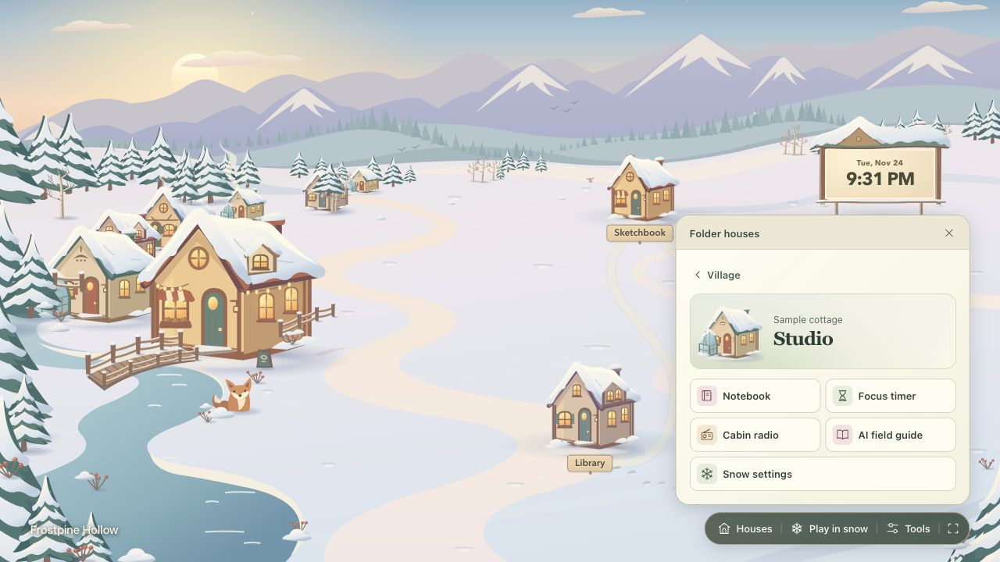

# Snowfall OS

An illustrated winter desktop for macOS. Follow the snowy streets to your folder cottages, pick up a loose file at the post office, or glance at the town clock. The buildings share a ground plane, perspective, and light with the landscape. Click an open patch to toss a snowball and Flurry will throw one back. Hold still to pack a snowman where your pointer rests. A little plow takes care of the foreground lane.


[Download for Mac](https://github.com/ult666666/snowfall-os/releases/latest/download/Snowfall-OS-macOS.zip) · [Explore the sample town](https://ult666666.github.io/snowfall-os/?v=8.0.0)

## Move into the village

On macOS 12 or later, unzip the download and open **Snowfall OS.app**. The app opens your playable village in a normal window. Close the window to leave it running on the wallpaper. Double-click the app or choose **Open Playable Village** from its snowflake menu to bring it forward again. The app is built for Apple silicon and Intel. Its public binary has an ad-hoc signature and has not been notarized by Apple.

If macOS asks for Desktop-folder access, choose **Allow** to connect the real folders and mail. The village opens while macOS checks folder access. Your cottages appear when the folder list arrives.

1. Choose **Folder Houses → Style Desktop Folders as Houses** from the snowflake menu. With desktop items hidden in macOS, the folders take up plots along the painted streets. Each cottage has a painted address sign with a folder emblem and its name. Hover or focus for a long name, click the cottage or its sign for a brief snowball exchange, or double-click to open the actual folder. In the playable window a single click also shows **Open folder** and **House widgets**. Its notebook and focus timer belong to the folder. On the wallpaper, right-click the door to reach them.
2. Pick up a letter on the post-office counter to open its file. The two counter spaces favor documents and pictures. Click the building to browse all loose Desktop items, including packages and aliases. The sorting desk can reveal any item in Finder.
3. Read the tower for local time. Its clock face opens Clock on supported Macs. In the browser you can switch the time format. Snowfall reads device time locally.
4. If you show existing widgets on the desktop, enable **Frame Desktop Widgets** in the snowflake menu. The artwork follows their bounds and leaves the controls to macOS. Each widget’s app supplies its content and appearance.
5. Choose **Wallpaper Image → Set Village as Mac Wallpaper** to save the occupied streets as the system picture. Snowfall updates the picture when its composition changes. The still picture stays when you quit. Open the app for working doors, time, and snow play.

For the composed layout, use **System Settings → Desktop & Dock** to hide Desktop items and choose **Only in Stage Manager** for **Click wallpaper to reveal desktop** with Stage Manager off. If you prefer visible Finder items, the village follows their real positions. File access stays available through Finder in either view.

## Restore your desktop

1. If you styled your folders, open the snowflake menu and choose **Folder Houses → Restore Original Folder Icons**. Snowfall restores saved custom artwork as well as standard Finder icons.
2. If you set the village as your system picture, choose **Wallpaper Image → Restore Previous Mac Wallpaper and Quit**. If you only used the live layer, quit Snowfall from the snowflake menu.
3. If you use different wallpapers across Spaces, visit each Space where you used the village. If a Space still shows Snowfall, select its previous picture in **System Settings → Wallpaper**. For an Apple dynamic wallpaper, choose the original under **Dynamic Wallpapers** and select **Dynamic**.

If you changed folder, widget, or wallpaper-click visibility during setup, return those choices to their previous values in **System Settings → Desktop & Dock**.



## How the drawing stays connected to the Mac

The landscape and the native door buttons share one placement plan. Each lot specifies where the front step meets the street and how large the building is at that depth. The Mac projects that plan onto the available display and reserves space for system widgets. Doors and letters have their own controls. Open ground accepts snow gestures. Finder keeps its own icon positions. On crowded or heavily cropped displays, every folder is also available through **Folder Houses → Open a House…**.

The post office watches the Desktop directory for changes. On a click, it checks that the item still has the expected identity before opening or revealing it. The still wallpaper stores the buildings and pieces of mail without filenames. The public website uses twelve fictional folders and three sample pieces of mail. [Placement plan](assets/village-plan.json) · [Native placement](macos/VillageComposition.swift) · [Local file handling](macos/PostOffice.swift)


The six 256-pixel cottage images are reused at different scales. Snowfall stores a compact Finder icon for each styled folder, plus a local backup of its previous icon when needed. The desktop picture cache reuses two JPEG slots per display. Snow and music run locally.

## Snow play

Try an open patch of the wallpaper, the playable Mac window, or the public sample town. The spot you choose is where the action begins.

- **Hold to pack.** Hold the mouse or trackpad button still as the base, belly and head stack up. Release to leave your snowman there. A short hold leaves a partial build you can finish later. Hold a finished snowman again to brush it away. The village remembers your 12 most recent placements.
- **Click to throw.** A quick click sends the first snowball. Click a snowman you built to challenge that particular friend. Flurry appears nearby and throws back on his own. Click Flurry to land your next throw. A puff of powder shows where each throw lands. Move the pointer clear of the incoming snowball to dodge. The first to three hits wins.
- **Watch the plow.** It drives in from the edge of the scene, clears snow, then leaves again. Planting a snowman can call it out for another pass. Click the left or right half of the moving plow to steer it.

In the playable window and web demo, you can also tab to the landscape, use the arrow keys to pick a spot, and tap or hold Space. The village menu in the upper-right corner opens the guided Snow Yard, folder list, tools, and full-screen view. On the Mac wallpaper, use the snowflake in the menu bar to reach those activities.

The browser preview uses fictional sample folders. It runs the same widget and game code and stores sample notes locally. Finder integration, desktop widget frames, and system wallpaper changes are available in the Mac app.

## Build on your Mac

Install Apple’s Command Line Tools, then run these commands from the project folder.

```sh
./build-mac.sh
open "build/Snowfall OS.app"
```

The bundled app works offline. To run its isolated integration check, execute `"build/Snowfall OS.app/Contents/MacOS/SnowfallOS" --smoke-test`. It exercises folder styling and restoration using temporary folders. Use `--check-free-snow` to verify native press and release handling, including a hold that reaches WebKit late. Use `--check-village-plan` to exercise Finder visibility and cottage placement across screen sizes. Run `swift tests/check-wallpaper-art.swift` to compare real WebKit pixels for each roof and nameplate. Pass a built .app path to that command to check its packaged artwork. These checks use isolated app data.

## Learn how an AI product takes shape

A folder has a persistent identity, a position in the drawing, and an action. Keeping these separate lets the art change while the same door continues to open the right files. This principle also applies to an AI assistant that suggests which folder to open. Its suggestion can refer to an item ID, and native code can check that ID before doing anything. The clock, file handling and snowball game all run locally with zero model calls. A practical product test is to hand someone the village without instructions and see whether they can identify their folder, grow a snowman beside it, and get that same snowman to throw back. The address sign, the growing body, and the incoming snowball each make a different action visible. The same test can catch discoverability problems in an AI-powered product. [Door controls](macos/PorchTargets.swift) · [Snowball exchange](porch.js) · [Full snow yard](yard.js)

**Try a design exercise.** A visitor writes “I have half an hour to finish my sketch” but doesn’t know which tool to open. How could a future guide help?

1. **Pick one outcome.** The visitor reaches the focus timer in one click after describing their goal.
2. **Limit the model’s choices.** Give it the visitor’s request and four allowed actions, `focus`, `notes`, `radio`, and `clarify`. A result such as `{"action":"focus"}` would let the app show an **Open focus timer** button for the visitor to choose.
3. **Plan for uncertainty.** If the response is invalid, arrives too late, or asks for clarification, show the ordinary list of tools. The visitor stays in control.
4. **Test it.** Gather 20 requests and label the intended tool together with their authors. Include requests with no clear match. Compare the proposed guide with a simple keyword rule on the same requests. Count correct suggestions, incorrect suggestions, and cases handed back to the visitor.

For a first code walkthrough, type a sentence into a cabin note and follow its `input` event into local storage. Then find how the timer remembers a deadline across sessions. [Mini-app source](apps.js) · [Native Mac implementation](macos/main.swift)

One bug in this village made that test concrete. The app counted 18 folder targets even when Finder’s full-screen layer hid every cottage sprite. The Mac now checks its desktop visibility settings and separately counts decoded cottage images with visible address signs. For an AI product, use the same distinction when testing a tool call. Verify the result the user can see and act on after the model requests it.
