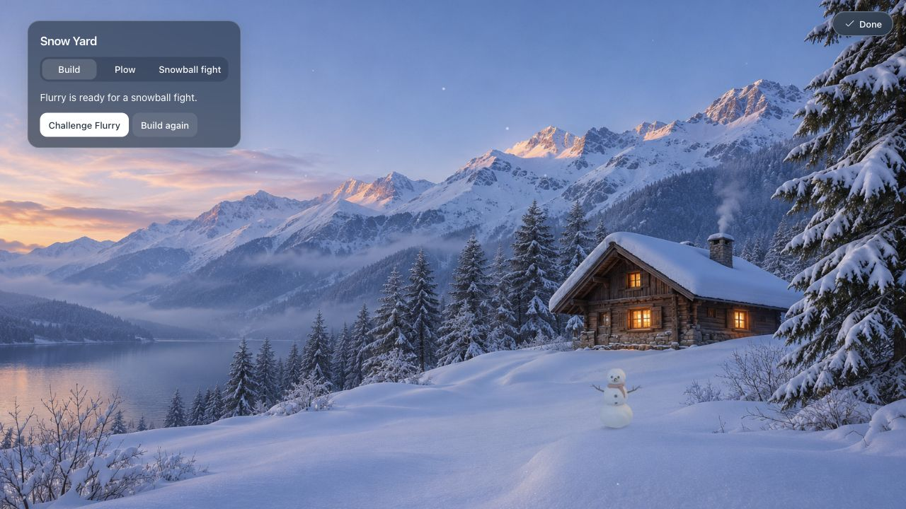

# Snowfall OS

An animated winter wallpaper for your Mac. Snow falls around a warmly lit cabin while your Finder icons, widgets, and open apps stay clickable. The snowflake in the menu bar lets you roll a snowball or send the plow across your desktop.

## Open the cabin

On macOS 12 or later, download **Snowfall-OS-macOS.zip**, unzip it, and open **Snowfall OS.app**. The wallpaper appears on every attached screen. Quit from the snowflake menu to return to your original wallpaper. [Download for Mac](https://github.com/ult666666/snowfall-os/releases/latest)


The browser preview lets you play in the snow yard and try the cabin tools. The Mac download adds the live wallpaper, menu bar controls, window-edge snow, and shortcuts to installed apps. [Play in your browser](https://ult666666.github.io/snowfall-os/)

### From the snowflake menu

- **Roll a Snowball** or **Send the Snowplow** to see the action travel across the wallpaper, behind your regular windows.
- **Wallpaper Image → Choose Image…** lets you use a picture from your Mac. Choose **Alpine Cabin** to return to the included scene.
- **Snow on App Windows** adds a dusting along the tops of visible app windows. The effect uses their positions and sizes, lets clicks pass through, and respects the system’s Reduce Motion setting.
- **Play in Snow** opens a resizable game window. Stack three snowballs to build Flurry, then challenge him. Click him to throw, and use the arrows to dodge the marked landing spot. First to three hits wins. In the plow activity, choose a snow pile to clear it and watch the tracks appear.
- **Tools** opens an offline radio, notes, a 25-minute focus timer with five-minute breaks, and a field guide with three short AI product lessons. The menu also offers shortcuts to Apple’s Music, Notes, and Clock apps when installed.



The cabin saves your snowman, notes, timer state, radio favorites, and settings locally. The Mac app and browser preview each keep their own saved data.

### Build from source

Install Apple’s Command Line Tools, then run these commands in the project folder. The script produces a universal app for Apple silicon and Intel.

```sh
./build-mac.sh
open "build/Snowfall OS.app"
```

The release uses an ad-hoc code signature and has no Apple notarization. If macOS blocks the downloaded copy, you can build it locally from the same source. [Build script](build-mac.sh)

## Learn how an AI product takes shape

The alpine landscape was generated with AI during development. The plow, snowballs, and snowman are rendered 3D miniatures with transparent backgrounds. Cabin Radio uses crops of that scenery for its sleeves. Each of its three original scores plays locally through Web Audio. Hand-coded rules decide where Flurry aims and which snow pile the plow clears. The bundled app works offline with zero model calls. [Game rules](yard.js) · [Radio scores and synthesis](radio.js)

**Try a design exercise.** A visitor writes “I have half an hour to finish my sketch” but doesn’t know which tool to open. How could a future guide help?

1. **Pick one outcome.** The visitor reaches the focus timer in one click after describing their goal.
2. **Limit the model’s choices.** Give it the visitor’s request and four allowed actions, `focus`, `notes`, `radio`, and `clarify`. A result such as `{"action":"focus"}` would let the app show an **Open focus timer** button for the visitor to choose.
3. **Plan for uncertainty.** If the response is invalid, arrives too late, or asks for clarification, show the ordinary list of tools. The visitor stays in control.
4. **Test it.** Gather 20 requests and label the intended tool together with their authors. Include requests with no clear match. Compare the proposed guide with a simple keyword rule on the same requests. Count correct suggestions, incorrect suggestions, and cases handed back to the visitor.

For a first code walkthrough, type a sentence into a cabin note and follow its `input` event into local storage. Then find how the timer remembers a deadline across sessions. [Mini-app source](apps.js) · [Native Mac implementation](macos/main.swift)
